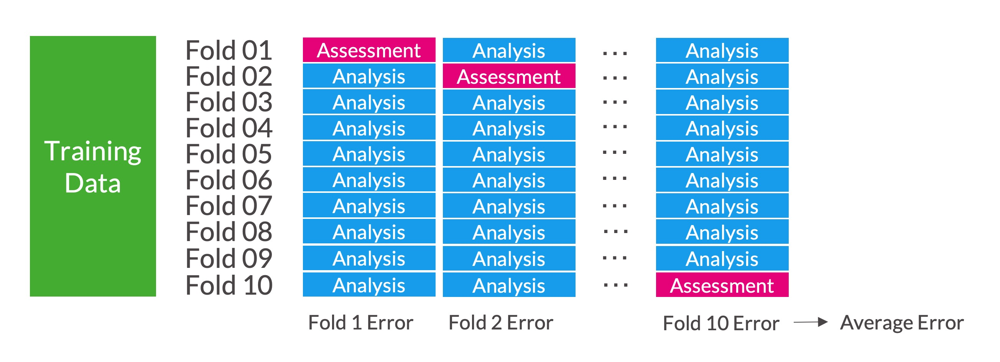

Image by [Marcel "lazytom" Marchon](https://en.wikipedia.org/wiki/Chicago_%22L%22#/media/File:Chicago_Elevated_Train.jpg)

```{r}
#| label: init-exercise-number
#| echo: false

exercise_number <- 1

```

```{r}
#| label: setup
#| echo: false
#| warning: false
#| message: false

library(tidyverse)
library(here)
library(gridExtra)

theme_set(theme_minimal())

```

## Regression

Predictive modeling is split into two approaches: regression and classification.

::: callout-tip
## Regression

Predictive modeling with a numeric outcome.

**Note:** Regression and ordinary least squares linear regression (which we often informally refer to simply as "linear regression") are different ideas. We will use many algorithms for regression applications that are not linear regression.
:::

::: callout-tip
## Classification

Predictive modeling with a categorical outcome. The output of these models can be predicted classes of a categorical variable or predicted probabilities (e.g. 0.75 for "A" and 0.25 for "B").
:::

This chapter will focus on regression. A later chapter focuses on classification.

With regression, our general goal is to fit $\hat{f}(\vec{x})$ using modeling data that will minimize predictive errors on unseen data. There are many algorithms for fitting $\hat{f}(\vec{x})$. For regression, most of these algorithms fit conditional means; however, some use conditional quantiles like the conditional median.

Families of predictive models:

-   linear
-   trees
-   naive and instance-based methods
-   kernel
-   neural networks (NN)

::: callout
#### [`r paste("Exercise", exercise_number)`]{style="color:#1696d2;"}

```{r}
#| label: increment-exercise-number-1
#| echo: false

exercise_number <- exercise_number + 1
```

1.  Name all of the algorithms you know for each family of predictive model.
:::

## Regression Algorithms

Let's explore a few algorithms for generating predictions in regression applications. Consider some simulated data with 1,000 observations, one predictor, and one outcome.

```{r}
#| label: simulate-data
#| warning: false

library(tidymodels)

set.seed(20201004)

x <- runif(n = 1000, min = 0, max = 10)

data1 <- bind_cols(
  x = x,
  y = 10 * sin(x) + x + 20 + rnorm(n = length(x), mean = 0, sd = 2)
)

```

For reasons explained later, we split the data into a training data set with 750 observations and a testing data set with 250 observations.

```{r}
#| label: split-simulated-data

set.seed(20201007)

# create a split object
data1_split <- initial_split(data = data1, prop = 0.75)

# create the training and testing data
data1_train <- training(x = data1_split)
data1_test  <- testing(x = data1_split)

```

@fig-simulated-training-data visualizes the training data.

```{r}
#| label: fig-simulated-training-data
#| fig-cap: Simulated training data

# visualize the data
data1_train |>
  ggplot(aes(x = x, y = y)) +
  geom_point(alpha = 0.25) +
  labs(title = "Example 1 Data") +
  theme_minimal()

```

### Linear Regression

1. Find the line that minimizes the sum of squared errors between the line and the observed data. 

**Note:** Linear regression is linear in its coefficients but can fit non-linear patterns in the data with the inclusion of higher order terms (for example, $x^2$).

@fig-simulated-regression shows four different linear regression models fit to the training data. Degree is the exponent of the highest order term included in the model.

For example, "Degree = 1" means $\hat{y}_i = b_0 + b_1x_i$ and "Degree = 3" means $\hat{y}_i = b_0 + b_1x_i + b_2x_i^2 + b_3x_i^3$.

```{r}
#| code-fold: true
#| label: fig-simulated-regression
#| fig-cap: Fitting the non-linear pattern in the data requires higher order terms

lin_reg_model1 <- linear_reg() |>
  set_engine(engine = "lm") |>
  set_mode(mode = "regression") |>
  fit(formula = y ~ x, data = data1_train)

lin_reg_model2 <- linear_reg() |>
  set_engine(engine = "lm") |>
  set_mode(mode = "regression") |>
  fit(formula = y ~ poly(x, degree = 2, raw = TRUE), data = data1_train)

lin_reg_model3 <- linear_reg() |>
  set_engine(engine = "lm") |>
  set_mode(mode = "regression") |>
  fit(formula = y ~ poly(x, degree = 3, raw = TRUE), data = data1_train)

lin_reg_model4 <- linear_reg() |>
  set_engine(engine = "lm") |>
  set_mode(mode = "regression") |>
  fit(formula = y ~ poly(x, degree = 4, raw = TRUE), data = data1_train)

# create a grid of predictions
new_data <- tibble(x = seq(0, 10, 0.1))

predictions_grid <- tibble(
  x = seq(0, 10, 0.1),
  `Degree = 1` = predict(object = lin_reg_model1, new_data = new_data)$.pred,
  `Degree = 2` = predict(object = lin_reg_model2, new_data = new_data)$.pred,
  `Degree = 3` = predict(object = lin_reg_model3, new_data = new_data)$.pred,
  `Degree = 4` = predict(object = lin_reg_model4, new_data = new_data)$.pred
) |>
  pivot_longer(-x, names_to = "model", values_to = ".pred")

ggplot() +
  geom_point(data = data1_train, aes(x = x, y = y), alpha = 0.25) +
  geom_path(data = predictions_grid, aes(x = x, y = .pred), color = "red") +
  facet_wrap(~model) +
  labs(
    title = "Example 1: Data with Predictions (Linear Regression)",
    subtitle = "Prediction in red"
  ) +
  theme_minimal()

```

### KNN {#sec-knn}

1.  Find the $k$ closest observations using only the predictors. Closeness is typically measured with Euclidean distance.
2.  Take the mean of the outcome variables for the $k$ closest observations.

```{r}
#| code-fold: true
#| label: fig-simulated-knn
#| fig-cap: Changing k leads to models that under and over fit to the data

# create a knn model specification
knn_mod1 <- 
  nearest_neighbor(neighbors = 1) |>
  set_engine(engine = "kknn") |>
  set_mode(mode = "regression") |>
  fit(formula = y ~ x, data = data1_train)

knn_mod5 <- 
  nearest_neighbor(neighbors = 5) |>
  set_engine(engine = "kknn") |>
  set_mode(mode = "regression") |>
  fit(formula = y ~ x, data = data1_train)

knn_mod50 <- 
  nearest_neighbor(neighbors = 50) |>
  set_engine(engine = "kknn") |>
  set_mode(mode = "regression") |>
  fit(formula = y ~ x, data = data1_train)

knn_mod500 <- 
  nearest_neighbor(neighbors = 500) |>
  set_engine(engine = "kknn") |>
  set_mode(mode = "regression") |>
  fit(formula = y ~ x, data = data1_train)

# create a grid of predictions
new_data <- tibble(x = seq(0, 10, 0.1))

predictions_grid <- tibble(
  x = seq(0, 10, 0.1),
  `KNN with k=1` = predict(object = knn_mod1, new_data = new_data)$.pred,
  `KNN with k=5` = predict(object = knn_mod5, new_data = new_data)$.pred,
  `KNN with k=50` = predict(object = knn_mod50, new_data = new_data)$.pred,
  `KNN with k=500` = predict(object = knn_mod500, new_data = new_data)$.pred
) |>
  pivot_longer(-x, names_to = "model", values_to = ".pred")

# visualize the data
ggplot() +
  geom_point(data = data1_train, aes(x = x, y = y), alpha = 0.25) +
  geom_path(data = predictions_grid, aes(x = x, y = .pred), color = "red") +
  facet_wrap(~model) +
  labs(
    title = "Example 1: Data with Predictions (KNN)",
    subtitle = "Prediction in red"
  ) +
  theme_minimal()

```

### Regression Trees

1.  Consider all binary splits of all predictors to split the data into two groups. Choose the split that minimizes the total sum of squared errors of the outcome variable, where each group's prediction is its mean.
2.  Repeat step 1 recursively until a stopping parameter is reached (cost complexity, minimum group size, tree depth).

[Decision Tree: The Obama-Clinton Divide](https://archive.nytimes.com/www.nytimes.com/imagepages/2008/04/16/us/20080416_OBAMA_GRAPHIC.html?scp=5&sq=Decision%20Obama%20clinton&st=cse) from the New York Times is a clear example of a decision tree.

```{r}
#| code-fold: true
#| label: fig-simulated-regression-trees
#| fig-cap: Changing the cost complexity parameter leads to models that are under or over fit to the data

reg_tree_mod1 <- 
  decision_tree(cost_complexity = 0.1) |>
  set_engine(engine = "rpart") |>
  set_mode(mode = "regression") |>
  fit(formula = y ~ x, data = data1_train)

reg_tree_mod2 <- 
  decision_tree(cost_complexity = 0.01) |>
  set_engine(engine = "rpart") |>
  set_mode(mode = "regression") |>
  fit(formula = y ~ x, data = data1_train)

reg_tree_mod3 <- 
  decision_tree(cost_complexity = 0.001) |>
  set_engine(engine = "rpart") |>
  set_mode(mode = "regression") |>
  fit(formula = y ~ x, data = data1_train)

reg_tree_mod4 <- 
  decision_tree(cost_complexity = 0.0001) |>
  set_engine(engine = "rpart") |>
  set_mode(mode = "regression") |>
  fit(formula = y ~ x, data = data1_train)

# create a grid of predictions
new_data <- tibble(x = seq(0, 10, 0.1))

predictions_grid <- tibble(
  x = seq(0, 10, 0.1),
  `Regression Tree with cp=0.1` = predict(object = reg_tree_mod1, new_data = new_data)$.pred,
  `Regression Tree with cp=0.01` = predict(object = reg_tree_mod2, new_data = new_data)$.pred,
  `Regression Tree with cp=0.001` = predict(object = reg_tree_mod3, new_data = new_data)$.pred,
  `Regression Tree with cp=0.0001` = predict(object = reg_tree_mod4, new_data = new_data)$.pred
) |>
  pivot_longer(-x, names_to = "model", values_to = ".pred")

# visualize the data
ggplot() +
  geom_point(data = data1_train, aes(x = x, y = y), alpha = 0.25) +
  geom_path(data = predictions_grid, aes(x = x, y = .pred), color = "red") +
  facet_wrap(~model) +
  labs(
    title = "Example 1: Data with Predictions (Regression Trees)",
    subtitle = "Prediction in red"
  ) +
  theme_minimal()

```

Regression trees generate a series of binary splits that can be visualized. Consider the simple tree from @fig-simulated-regression-trees where `cp=0.1`.

```{r}
#| label: plot-regression-tree
#| code-fold: true
#| message: false

library(rpart.plot)

rpart.plot(reg_tree_mod1$fit, roundint = FALSE)

```

Linear regression is a parametric approach. It requires making assumptions about the functional form of the data and reducing the model to a finite number of parameters.

KNN and regression trees are nonparametric approaches to predictive modeling because they do not require an assumption about the functional form of the model. The data-driven approach of nonparametric models is appealing because it requires fewer assumptions, but it often requires more data and care to not overfit the modeling data.

Regression trees are the simplest tree-based algorithms. Other tree-based algorithms, like gradient-boosted trees and random forests, often have far better performance than regression trees.

::: callout
#### [`r paste("Exercise", exercise_number)`]{style="color:#1696d2;"}

```{r}
#| label: increment-exercise-number-2
#| echo: false

exercise_number <- exercise_number + 1
```

1.  Use `library(tidymodels)` to fit a KNN model to the `data1_train`. Pick any plausible value of $k$.
2.  Make predictions on the testing data.
3.  Evaluate the model using `rmse()`.
:::

## Error

Different applications call for different error metrics. Root mean squared error (RMSE) and mean squared error (MSE) are popular metrics for regression. 

$$
RMSE = \sqrt{\frac{1}{n}\sum_{i = 1}^n (y_i - \hat{y}_i)^2}
$$ {#eq-rmse}

$$
MSE = \frac{1}{n}\sum_{i = 1}^n (y_i - \hat{y}_i)^2
$$ {#eq-mse}

Let's consider the MSE for a single observation $(x_0, y_0)$ and think about the model that generates $\hat{y}_0$, which we will denote $\hat{f}(x_0)$.

$$
MSE = (y_0 - \hat{f}(x_0))^2
$$ {#eq-mse-single}

Assume the data are generated by $y = f(x) + \epsilon$, where $f$ is the true (unknown) function and $\epsilon$ is independent of $x$ and of the training data with $E[\epsilon] = 0$ and $Var(\epsilon) = \sigma^2$. Taking expectations over both $\epsilon$ and the training samples used to fit $\hat{f}$, we can decompose the expected value of MSE into three types of error: irreducible error, bias error, and variance error. Understanding the types of error will inform modeling decisions.

$$
E[MSE] = E[(y_0 - \hat{f}(x_0))^2] = Var(\epsilon) + [Bias(\hat{f}(x_0))]^2 + Var(\hat{f}(x_0))
$$ {#eq-mse-ev1}

$$
E[MSE] = E[(y_0 - \hat{f}(x_0))^2] = \sigma^2 + (\text{model bias})^2 + \text{model variance}
$$ {#eq-mse-ev2}

::: callout-tip
## Irreducible error ($\sigma^2$)

Error that can't be reduced regardless of model quality. This is often caused by factors that affect the outcome of interest that aren't measured or included in the data set.
:::

::: callout-tip
## Bias error

Difference between the expected prediction of a predictive model and the correct value. Bias error is generally the error that comes from approximating complicated real-world problems with relatively simple models.
:::

Here, the model on the left does a poor job fitting the data (high bias) and the model on the right does a decent job fitting the data (low bias).

```{r}
#| label: fig-model-bias
#| code-fold: true
#| fig-height: 2.5
#| fig-width: 4
#| fig-align: "center"
#| fig-cap: Bias
#| message: false
#| warning: false
set.seed(20200225)

sample1 <- tibble(
  x = runif(100, min = -10, max = 10),
  noise = rnorm(100, mean = 10, sd = 10),
  y = -(x ^ 2) + noise
)

grid.arrange(
  sample1 |>
    ggplot(aes(x, y)) +
    geom_point(alpha = 0.5) +
    geom_smooth(method = "lm",
                se = FALSE) +
    theme_void() +
    labs(title = "High Bias") +
    theme(plot.margin = unit(c(1, 1, 1, 1), "cm")),
  
  sample1 |>
    ggplot(aes(x, y)) +
    geom_point(alpha = 0.5) +
    geom_smooth(se = FALSE,
                span = 0.08) +
    theme_void() +
    labs(title = "Low Bias") +
    theme(plot.margin = unit(c(1, 1, 1, 1), "cm")),
  ncol = 2
)
```

::: callout-tip
## Variance error

How much the predicted value ($\hat{y}$) and fitted model ($\hat{f}$) change for a given data point when using a different sample of data to fit the model.
:::

Here, the model on the left does not change much as the training data change (low variance) and the model on the right changes a lot when the training data change (high variance).

```{r}
#| label: fig-model-variance
#| code-fold: true
#| fig-cap: Variance
#| message: false
#| warning: false
#| fig-height: 4

set.seed(20200226)

sample2 <- tibble(
  sample_number = rep(c("Sample 1", "Sample 2", "Sample 3", "Sample 4"), 100),
  x = runif(400, min = -10, max = 10),
  noise = rnorm(400, mean = 10, sd = 10),
  y = -(x ^ 2) + noise
)

grid.arrange(
  sample2 |>
    ggplot(aes(x, y)) +
    geom_point(alpha = 0.5) +
    geom_smooth(method = "lm",
                se = FALSE,
                alpha = 0.5) +
    facet_wrap(~sample_number) +
    theme_void() +
    labs(title = "Low Variance") +
    theme(plot.margin = unit(c(1, 1, 1, 1), "cm")),
  
  sample2 |>
    ggplot(aes(x, y)) +
    geom_point(alpha = 0.5) +
    geom_smooth(se = FALSE,
                span = 0.08,
                alpha = 0.5) +
    facet_wrap(~sample_number) +
    theme_void() +
    labs(title = "High Variance") +
    theme(plot.margin = unit(c(1, 1, 1, 1), "cm")),
  ncol = 2
)
```

As can be seen in the error decomposition and plots above, there is generally a trade-off between bias error and variance error. As model complexity increases, bias error tends to decrease and variance error tends to increase, so the goal is the level of complexity that minimizes their sum.

The bias-variance trade-off can generally be reconceived as

-   underfitting-overfitting tradeoff
-   simplicity-complexity tradeoff

```{r bias-variance-tradeoff, echo = FALSE, fig.height = 2.5, fig.width = 4, fig.align = "center"}
tribble(
  ~x, ~bias_squared, ~variance,
  0, 10, 3,
  1, 7, 3.02,
  2, 5, 3.05,
  3, 4, 3.1,
  4, 3.5, 3.15,
  5, 3.25, 3.25,
  6, 3.15, 3.5,
  7, 3.1, 4,
  8, 3.05, 5, 
  9, 3.02, 7, 
  10, 3, 10
  ) |>
  mutate(total_error = bias_squared + variance) |>
  pivot_longer(-x, names_to = "key", values_to = "value") |>
  ggplot(aes(x, value, color = key)) +
  geom_point() +
  geom_line() +
  scale_x_continuous(labels = NULL) +
  scale_y_continuous(limits = c(0, NA),
                     labels = NULL) +
  labs(x = "Complexity or Overfitting",
       y = "Error") +
  theme_minimal()
```

Our objective is to make accurate predictions on unseen data. It is important to make sure that models make accurate predictions on the modeling data and the implementation data.

::: callout-tip
## In-sample error

The predictive error of a model measured on the data used to estimate the predictive model.
:::

::: callout-tip
## Out-of-sample error

The predictive error of a model measured on the data not used to estimate the predictive model. Out-of-sample error is generally greater than the in-sample error.
:::

::: callout-tip
## Generalizability

How well a model makes predictions on unseen data relative to how well it makes predictions on the data used to estimate the model.
:::

## Spending Data

Predictive modelers strategically "spend data" to create accurate models that generalize to the implementation data. We will focus on two strategies: the training-testing split and v-fold cross validation.

::: callout-tip
## Training data

A subset of data used to develop a predictive model. The share of data committed to a training set depends on the number of observations, the number of predictors in a model, and heterogeneity in the data. 0.8 is a common share.
:::

::: callout-tip
## Testing data

A subset of data used to estimate model performance. The testing set usually includes all observations not included in the training set. Do not look at these data until the very end and only estimate the out-of-sample error rate on the testing set once. If the testing data are used repeatedly to compare or revise models, the final error rate will tend to underestimate the true out-of-sample error rate.
:::

{#fig-cv}

::: callout-tip
## $v$-fold Cross-Validation

Break the data into $v$ equal-sized, exclusive groups. Train the model on data from $v - 1$ folds (analysis data) and measure the error metric (e.g. RMSE) on the left-out fold (assessment data). Repeat this process $v$ times, each time leaving out a different fold. Average the $v$ error metrics.

$v$-fold cross-validation is sometimes called $k$-fold cross-validation.
:::

Strategies for spending data differ based on the application and the size and nature of the data. Ideally, the training-testing split is made at the beginning of the modeling process. The $v$-fold cross-validation is used on the training data for comparing

1.  approaches for feature/target engineering
2.  algorithms
3.  hyperparameter tuning

::: callout-tip
## Data Leakage

When information that won't be available when the model makes out-of-sample predictions is used when estimating a model. Looking at data from the testing set creates data leakage. Data leakage leads to an underestimate of out-of-sample error.
:::

::: {.callout-warning}
Feature and target engineering is a common source of data leakage. 

For example, regularized regression models expect variables to be normalized (subtract the sample mean from each predictor and divide by the sample standard deviation). A naive approach would be to calculate the means and standard deviations once on the full data set and use them on the testing data or use them in cross validation. This causes data leakage and biased underestimates of the out-of-sample error rate.

New means and standard deviations need to be estimated every time a model is fit including within each iteration of a resampling method! This is a lot of work, but `library(tidymodels)` makes this simple.
:::

## Predictive Modeling Pipelines

The rest of this chapter focuses on a predictive modeling pipeline applied to the simulated data. This pipeline is a general approach to creating predictive models and can change based on the specifics of an application. We will demonstrate the pipeline using KNN and regression trees. 


0. Problem Formulation
1. Split data into training and testing data
2. Exploratory Data Analysis
3. Set up Resampling for Model Selection
4. Create Candidate Models
5. Test and Choose the "Best" Model
6. Optional: Finalize the Model Fit
7. Evaluate the Final Model and Make a Go/No Go Decision
8. Optional: Deploy the Final Model
9. Monitor the Deployed Model


### Example: KNN

#### 0. Problem Formulation

We need to predict policy-relevant variable $y$ using $x$ as our predictor. Based on some data collection from last year, we have a data set with $(y, x)$ and we'll have $x$ where we'll deploy the model. We'll use RMSE as our error metric because we want to minimize errors overall with extra emphasis on avoiding large predictive errors.

#### 1. Split data into training and testing data

```{r}
#| label: knn-split-data

set.seed(20201007)

# create a split object
data1_split <- initial_split(data = data1, prop = 0.75)

# create the training and testing data
data1_train <- training(x = data1_split)
data1_test  <- testing(x = data1_split)

```

#### 2. Exploratory Data Analysis

:::{.callout-warning}
Only perform EDA on the training data. 

Exploring the testing data will lead to data leakage. 
:::

```{r}
#| label: knn-eda

data1_train |>
  ggplot(aes(x = x, y = y)) +
  geom_point(alpha = 0.25) +
  labs(title = "Example 1 Data") +
  theme_minimal()

```

#### 3. Set up Resampling for Model Selection

We use 10-fold cross validation for hyperparameter tuning and model selection. The training data are small (750 observations and one predictor), so we will repeat the entire cross validation process five times.

Estimating out-of-sample error rates with cross-validation is an uncertain process. Repeated cross-validation reduces the variance of our estimated error rates.

```{r}
#| label: knn-resampling

data1_folds <- vfold_cv(data = data1_train, v = 10, repeats = 5)

```

#### 4. Create Candidate Models

We have three main levers for creating candidate models:

1. **Feature and target engineering.** Feature and target engineering is generally specified when creating a recipe with `recipe()` and `step_*()` functions. 
2. **Switching algorithms.** Algorithms are specified using functions from `library(parsnip)`.
3. **Hyperparameter tuning.** Hyperparameter tuning is typically handled by using `tune()` when picking an algorithm and then creating a hyperparameter tuning grid. 

It is common to normalize (subtract the sample mean and divide by the sample standard deviation) predictors when using KNN. Otherwise, predictors measured on larger scales dominate the distance calculation. With only one predictor, normalizing does not change which observations are closest, but we include it because it is standard practice.

```{r}
#| label: knn-recipe

knn_recipe <-
  recipe(formula = y ~ ., data = data1_train) |>
  step_normalize(all_predictors())

```

We use `nearest_neighbor()` to create a KNN model and we use `tune()` as a placeholder for `k`. Note that we can tune many hyperparameters for a given model. The Regression Tree example later in this chapter illustrates this concept.

```{r}
#| label: knn-model

knn_mod <-
  nearest_neighbor(neighbors = tune()) |>
  set_engine(engine = "kknn") |>
  set_mode(mode = "regression")

```

We use `grid_regular()` to specify a hyperparameter tuning grid for potential values of $k$.

```{r}
#| label: knn-grid

knn_grid <- grid_regular(neighbors(range = c(1, 99)), levels = 10)

knn_grid

```

Finally, we combine the recipe and model objects into a `workflow()`. 

```{r}
#| label: knn-workflow

knn_workflow <-
  workflow() |>
  add_recipe(recipe = knn_recipe) |>
  add_model(spec = knn_mod)

```

#### 5. Test and Choose the "Best" Model 

`tune_grid()` fits the models to the repeated cross validation with differing hyperparameters and captures RMSE against each assessment data set. 

```{r}
#| label: knn-tune

knn_res <-
  knn_workflow |>
  tune_grid(
    resamples = data1_folds,
    grid = knn_grid,
    metrics = metric_set(rmse)
  )

```

We can quickly extract information from the tuned results object with functions like `collect_metrics()`, `show_best()`, and `autoplot()`.

```{r}
#| label: knn-tune-results

knn_res |>
  collect_metrics()

knn_res |>
  show_best(metric = "rmse")

knn_res |>
  autoplot()

```

#### 6. Optional: Finalize the Model Fit

Sometimes we will pick the best predictive model specification (feature and target engineering + algorithm + hyperparameters) and fit the model on all of the training data. 

First, finalize the workflow with the "best" hyperparameters from the tuned results. 

```{r}
#| label: knn-finalize-workflow

final_wf <-
  knn_workflow |> 
  finalize_workflow(select_best(knn_res, metric = "rmse"))

```

Second, use `last_fit()` to fit the model on all of the training data and evaluate it once on the testing data.

```{r}
#| label: knn-last-fit

final_fit <-
  final_wf |>
  last_fit(data1_split)

```

::: {.callout-note}

`select_best()` takes a narrow view of model selection and picks the model with the lowest error rate. 

It is important to consider other elements when picking a "best." Other considerations include parsimony, cost, and equity. 

:::

#### 7. Evaluate the Final Model and Make a Go/No Go Decision

The final fit object contains the out-of-sample error metric from the testing data. This metric is our best estimate of model performance on unseen data. 

In this case, the testing data error is slightly higher than the cross-validated error from step 5, which makes sense.

```{r}
#| label: knn-test-metrics

final_fit |>
  collect_metrics()

```

#### 8. Optional: Deploy the Final Model

`final_fit` and `predict()` can be used to apply the model to new, unseen data. 

Only implement the model if it achieves the objectives set during problem formulation. 

#### 9. Monitor the Deployed Model

Model performance often decays over time because of changes in the predictors, changes in the outcome variables, and changes in the relationship between predictors and the outcome. It is important to monitor deployed models and make recurring go/no go decisions.

### Example: Regression Trees

We'll next work with a subset of data from the `Chicago` data set from `library(tidymodels)`. 

```{r}
#| label: chicago-data

chicago_small <- Chicago |>
  select(
    ridership,
    Clark_Lake,
    Quincy_Wells,
    Irving_Park,
    Monroe,
    Polk,
    temp,
    percip,
    Bulls_Home,
    Bears_Home,
    WhiteSox_Home,
    Cubs_Home,
    date
  ) |>
  mutate(weekend = wday(date, label = TRUE) %in% c("Sat", "Sun")) |>
  glimpse()

```

#### 0. Problem Formulation

The variable `ridership` is the outcome variable. It measures daily ridership, in thousands of riders, at the Clark/Lake L station in Chicago. The variables `Clark_Lake`, `Quincy_Wells`, `Irving_Park`, `Monroe`, and `Polk` measure ridership at several stations *14 days before* the `ridership` variable. 

The objective is predict `ridership` to better allocate staff and resources to the Clark/Lake L station. We have a clear setup between our modeling data and implementation data. Once again, we'll use RMSE which balances the desire to be right on average and to avoid very large predictive errors.

#### 1. Split data into training and testing data

```{r}
#| label: chicago-split-data

set.seed(20231106)

# create a split object
chicago_split <- initial_split(data = chicago_small, prop = 0.8)

# create the training and testing data
chicago_train <- training(x = chicago_split)
chicago_test  <- testing(x = chicago_split)

```

::: {.callout-warning}
## Random splits and time series

For simplicity, this example splits the data randomly. The Chicago data are a daily time series, so a random split puts days from the future into the training data and lets the model learn from days that sit right next to the testing days. This is a form of data leakage, so the testing error below likely underestimates how the model would perform in deployment.

In a real application, we would train on earlier dates and test on later dates (for example, with `initial_time_split()`).
:::

#### 2. Exploratory Data Analysis

[This chapter](https://bookdown.org/max/FES/visualizations-for-numeric-data-exploring-train-ridership-data.html) in "**Feature and Target Engineering**" contains EDA for the data set of interest.

#### 3. Set up Resampling for Model Selection

We use 10-fold cross validation for hyperparameter tuning and model selection. The training data are larger than in the previous example, so we skip repeats. 

```{r}
#| label: chicago-resampling

chicago_folds <- vfold_cv(data = chicago_train, v = 10)

```

#### 4. Create Candidate Models

We will use regression trees for this example. For feature and target engineering, we will simply remove the date column.

```{r}
#| label: rpart-recipe

rpart_recipe <-
  recipe(formula = ridership ~ ., data = chicago_train) |>
  step_rm(date)

```

We specify a regression tree with the rpart engine.

```{r}
#| label: rpart-model

rpart_mod <-
  decision_tree(
    cost_complexity = tune(),
    tree_depth = tune(),
    min_n = tune()
  ) |>
  set_engine(engine = "rpart") |>
  set_mode(mode = "regression")

```

We use `grid_regular()` to specify a hyperparameter tuning grid for potential values of the cost-complexity parameter, tree depth parameter, and minimum n.

```{r}
#| label: rpart-grid

rpart_grid <- grid_regular(
  cost_complexity(range = c(-5, -1)), 
  tree_depth(range = c(3, 15)), 
  min_n(),
  levels = 10
)

rpart_grid

```

Finally, we combine the recipe and model objects into a `workflow()`. 

```{r}
#| label: rpart-workflow

rpart_workflow <-
  workflow() |>
  add_recipe(recipe = rpart_recipe) |>
  add_model(spec = rpart_mod)

```

#### 5. Test and Choose the "Best" Model

```{r}
#| label: rpart-tune

rpart_res <-
  rpart_workflow |>
  tune_grid(resamples = chicago_folds,
            grid = rpart_grid,
            metrics = metric_set(rmse))

rpart_res |>
  collect_metrics()

rpart_res |>
  show_best(metric = "rmse")

rpart_res |>
  select_best(metric = "rmse")

rpart_res |>
  autoplot()

```

#### 6. Optional: Finalize the Model Fit

Sometimes we will pick the best predictive model specification (feature and target engineering + algorithm + hyperparameters) and fit the model on all of the training data. 

First, finalize the workflow with the "best" hyperparameters from the tuned results. 

```{r}
#| label: rpart-finalize-workflow

final_wf <-
  rpart_workflow |> 
  finalize_workflow(select_best(rpart_res, metric = "rmse"))

```

Second, use `last_fit()` to fit the model on all of the training data and evaluate it once on the testing data.

```{r}
#| label: rpart-last-fit

final_fit <-
  final_wf |>
  last_fit(chicago_split)

```

#### 7. Evaluate the Final Model and Make a Go/No Go Decision

The final fit object contains the out-of-sample error metric from the testing data. This metric is our best estimate of model performance on unseen data. 

In this case, the testing data error is slightly higher than the cross-validated error from step 5, which makes sense.

```{r}
#| label: rpart-test-metrics

final_fit |>
  collect_metrics()

```

#### 8. Optional: Deploy the Final Model

If we think an RMSE of around 2,340 riders is appropriate, we can implement this model for the Chicago Transit Authority. 

Instead, we're going back to the drawing board in our class lab to see if we can do better.[^testing-data]

[^testing-data]: Pretend we haven't already touched the testing data!

#### 9. Monitor the Deployed Model

This set up is ideal for monitoring the deployed model because we can compare predicted ridership with observed ridership every day. We can break this monitoring into four distinct steps.

1. **Structural validity:** Does the implementation data have the same structure as the modeling data? For example, does the delay in the 2025 American Community Survey shrink the set of available predictors?
2. **Input validation:** Do the predictors in the modeling data look like the implementation data? For example, are folks no longer going to Chicago Bulls games because the Bulls are bad?
3. **Output distribution:** Do the distributions of predicted and observed values in the implementation data look like the distribution of the outcome in the modeling data? For example, did ridership decline 50% because of a global pandemic?
4. **Relationship:** Do the predicted values look like the observed values? Is there concept drift? For example, does the RMSE look similar on the implementation data to the modeling data?
